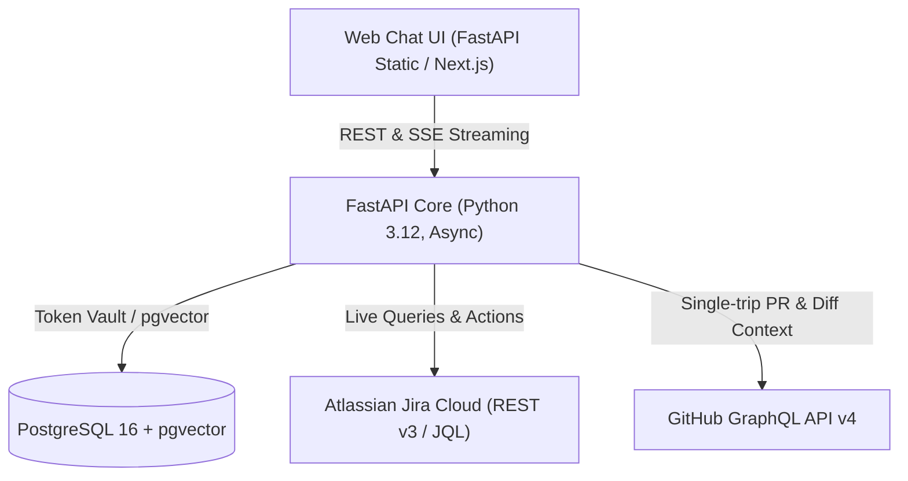

# Jira-GitHub AI Assistant for PMs & Developers

An intelligent FastAPI system connecting Jira project tracking with GitHub code repositories through a **Hybrid Architecture**:
1. **Live State & Ticket Actions (Text-to-JQL):** Queries for live ticket statuses, sprint progress, assignees, and blockers are executed live against Atlassian Jira Cloud REST API v3 (zero stale data).
2. **Historical Fixes & Semantic Search (Vector RAG):** Historical bug resolutions, descriptions, comments, and linked PR diffs are indexed into PostgreSQL `pgvector` for semantic search.
3. **Single-Roundtrip Code Retrieval:** Utilizes GitHub GraphQL v4 to retrieve PRs, commit histories, and code diffs simultaneously.
4. **Bi-directional Ticket Lifecycle:** Read tickets, create new tickets, and transition/close existing tickets directly from chat.
5. **Token Vault:** Integration credentials (Jira API tokens and GitHub PATs) are encrypted at rest using AES-256 (`cryptography.fernet`).

---

## Architecture Overview



---

## Quickstart

### 1. Requirements
- Python 3.10+ (tested on Python 3.12)
- Docker & Docker Compose (for PostgreSQL + `pgvector`)

### 2. Environment Configuration
Copy `.env.example` to `.env`:
```bash
cp .env.example .env
```
Ensure `ENCRYPTION_KEY` is set (a sample 32-byte Fernet key is provided in `.env`).

### 3. Start Database (PostgreSQL + `pgvector`)
```bash
docker compose up -d
```

### 4. Install Dependencies
```bash
python3 -m venv .venv
source .venv/bin/activate
pip install -r requirements.txt
```

### 5. Run the Application
```bash
uvicorn app.main:app --reload --port 8000
```
Open **[http://localhost:8000](http://localhost:8000)** in your browser to access the dashboard.
Interactive OpenAPI docs are available at **[http://localhost:8000/docs](http://localhost:8000/docs)**.

---

## Running Automated Tests
```bash
.venv/bin/pytest -v
```

---

## API Endpoints Summary

### Authentication (`/api/v1/auth`)
- `POST /api/v1/auth/otp/request` — Request passwordless 6-digit email OTP
- `POST /api/v1/auth/otp/verify` — Verify code & receive JWT access + refresh tokens
- `POST /api/v1/auth/refresh` — Refresh access token
- `GET /api/v1/auth/me` — Authenticated user profile

### Integrations & Token Vault (`/api/v1/integrations`)
- `POST /api/v1/integrations/jira` — Validate & encrypt Jira API token
- `POST /api/v1/integrations/github` — Validate & encrypt GitHub Read PAT
- `GET /api/v1/integrations/status` — Status of connected services (zero secret leakage)

### Project Mappings (`/api/v1/mappings`)
- `POST /api/v1/mappings` — Map Jira Project Key (`ENG`) to GitHub Repo (`owner/repo`)
- `GET /api/v1/mappings` — List user's project mappings
- `DELETE /api/v1/mappings/{id}` — Remove a mapping

### Chat Assistant (`/api/v1/chat`)
- `POST /api/v1/chat/message` — Send query to assistant (synchronous JSON response)
- `POST /api/v1/chat/stream` — Real-time Server-Sent Events (SSE) streaming with tool execution audit
- `GET /api/v1/chat/sessions` — Chat history and sessions

### Webhooks (`/api/v1/webhooks`)
- `POST /api/v1/webhooks/jira` — Real-time Jira issue updates to `pgvector`
- `POST /api/v1/webhooks/github` — PR merge listener linking code diffs to Jira tickets
